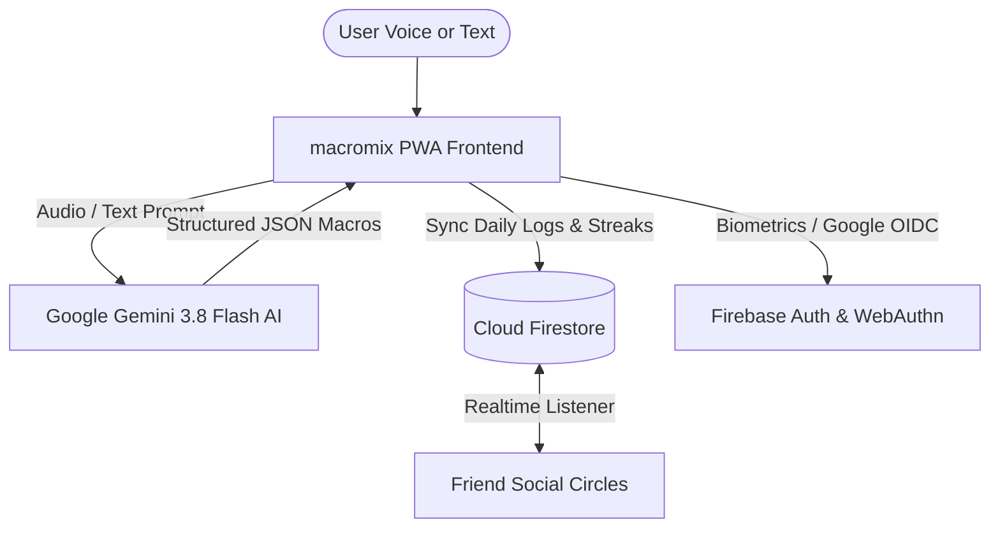

# 🥣 macromix

> **Voice-first, neo-brutalist macro and calorie tracker powered by Google Gemini AI and Firebase.**  
> Zero tedious barcode scanning. Speak or type your meal naturally, and macromix calculates calories, macros, and portions in seconds.

[](https://macromix.web.app)
[](https://macromix.web.app)
[](https://aistudio.google.com/)
[](https://firebase.google.com/)
[](LICENSE)

---

## ⚡ Highlights

* **🎙️ Natural Voice & Text Logging:** Say *"Had 2 rotis with a bowl of dal, 150g grilled chicken, and an apple"* — Gemini breaks down items, standardized gram weights, calories, protein, carbs, fat, and fiber.
* **🎨 Neo-brutalist Aesthetics:** Bold high-contrast UI, thick borders, brutalist drop-shadows, animated nutrient rings, and fluid responsive design across mobile and desktop.
* **🛡️ Passwordless Biometric Passkeys & Google OIDC:** Sign in with Face ID, Touch ID, or Google 1-Tap authentication. No passwords to remember or leak.
* **🔥 Daily Streak & Friends System:** Maintain daily consistency streaks (🔥), discover friends by handle, and view their daily macromix circles in real time.
* **📱 Full Offline-Capable PWA:** Install directly to your iOS or Android home screen with instant caching, standalone window frame, and local-first persistence.

---

## 🏗️ Architecture



---

## 🛠️ Tech Stack

| Layer | Technology |
|---|---|
| **Frontend** | Vanilla ES6+ JavaScript, Semantic HTML5, Neo-brutalist CSS3 |
| **AI Engine** | Google Gemini (`gemini-3.8-flash`, `gemini-3.6-flash`, `gemini-flash-latest`) |
| **Database** | Google Cloud Firestore (Real-time snapshots, multi-device sync) |
| **Authentication** | SimpleWebAuthn (Passkeys / FIDO2) + Firebase Auth (Google OIDC) |
| **Hosting** | Google Firebase Hosting CDN |

---

## 🚀 Quick Start (Local Development)

### 1. Clone the repository
```bash
git clone https://github.com/istashcodes/macromix.git
cd macromix
```

### 2. Configure Gemini API Key
You can configure your Google Gemini API key in either of two ways:

* **Option A (Local config file):**
  Copy `env.example.js` to `env.js` and paste your key from [Google AI Studio](https://aistudio.google.com/app/apikey):
  ```bash
  cp env.example.js env.js
  ```
  Edit `env.js`:
  ```javascript
  window.__ENV = {
    GEMINI_API_KEY: "AIzaSy..."
  };
  ```
  *(Note: `env.js` is included in `.gitignore` and is never committed to Git).*

* **Option B (Directly in UI):**
  Launch the app, tap your streak/handle in the header to open **Settings**, and paste your API key under the **Gemini AI Key** card. It saves to your browser's secure `localStorage`.

### 3. Run a local web server
Because `macromix` is a zero-dependency static PWA, you can use any static file server:

```bash
# Using Python 3
python3 -m http.server 8000

# OR using Node.js
npx serve .
```

Open `http://localhost:8000` in your browser.

---

## 🚢 Deployment to Firebase Hosting

`macromix` is served as a static progressive web app on Firebase Hosting.

### Manual Deploy (Firebase CLI)
```bash
firebase deploy --only hosting
```

### Continuous Deployment via GitHub Actions
If you fork or manage this repository with GitHub Actions, pushing commits to `main` automatically deploys the site to Firebase Hosting using [`.github/workflows/deploy.yml`](.github/workflows/deploy.yml).

Configure these repository secrets under **Settings > Secrets and variables > Actions**:
* `GEMINI_API_KEY`: Your Gemini API key (injected into `env.js` during deployment).
* `FIREBASE_TOKEN`: CI token generated via `npx firebase-tools login:ci`.

---

## 📁 Repository Structure

```text
macromix/
├── index.html                   # Core PWA markup and modals
├── styles.css                   # Neo-brutalist design system & responsive layout
├── app.js                       # Frontend controller, macro math, Gemini client
├── firebase-db.js               # Cloud Firestore & Firebase Auth integration
├── manifest.json                # PWA manifest (app name, icons, theme colors)
├── service-worker.js            # Offline asset caching & PWA service worker
├── simplewebauthn-browser.min.js# Passkey / WebAuthn client library
├── env.example.js               # Template for local environment config
├── firebase.json                # Firebase Hosting, Firestore, and Auth rules
├── firestore.rules              # Granular Cloud Firestore security rules
└── .github/workflows/
    └── deploy.yml               # Automated deployment to Firebase Hosting
```

---

## 🔒 Security & Privacy

* **Direct AI Communication:** Food prompts and audio recordings are processed via Google Gemini API without intermediate third-party tracking.
* **No Hardcoded Secrets:** Client keys are decoupled via `.gitignore`, browser `localStorage`, and encrypted GitHub Actions Secrets.
* **Firestore Security Rules:** Access to user profiles and meal logs is restricted using strict Firestore security rules enforced at the database level.
* **Phishing-Resistant Auth:** WebAuthn credentials use public-key cryptography tied specifically to the application domain.

---

## 📄 License

This project is licensed under the [MIT License](LICENSE).